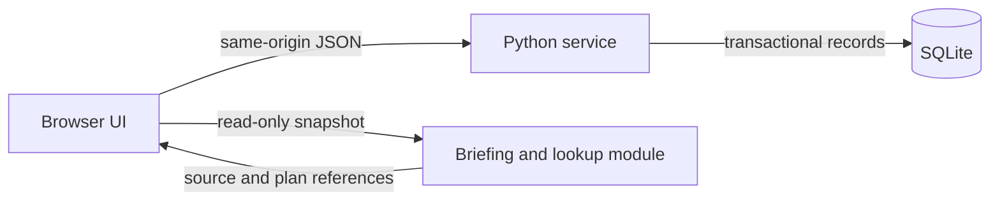

# Relay V1 technical architecture

## Runtime shape

`server.py` runs one loopback-only HTTP process at `127.0.0.1`. Browser modules call its same-origin JSON API. SQLite persists source records and plan version links. The current build has no external service, identity provider, model provider, background worker, or real-time channel.

## Data model

| Record | Fields | Role |
| --- | --- | --- |
| Household | internal ID, session token hash | Isolates a browser-local synthetic workspace. |
| Source | ID, original wording, review status, title, date, time, affected person, target plan | Retains untrusted input and its reviewed structured values. |
| Plan version link | household, plan ID, source ID | Creates an ordered, source-linked history for a plan. |
| Plan projection | current source values and earlier linked source values | Built from version links for the UI and reasoning module. |
| Follow-through action | household, action ID, plan ID, assigned person, open/done state | Tracks a practical local action without claiming external completion. |
| Migration ledger | ordered schema versions | Applies idempotent SQLite migrations before the server accepts requests. |
| Members | household and case-folded display name | Resolves intake names within a workspace and validates plan and task person fields. |

The session token never enters SQLite in readable form. A request cookie is HttpOnly and SameSite=Strict with an `/api/` path. A browser with no valid session gets a new synthetic household only through `GET /api/state`.

## API boundary

| Endpoint | Method | Operation |
| --- | --- | --- |
| `/api/state` | GET | Return the authorized household snapshot, creating a synthetic workspace when needed. |
| `/api/intake` | POST | Preserve pasted text and create a pending source. |
| `/api/review` | POST | Approve or reject a pending source. Approval adds a plan or a new plan version. |
| `/api/export` | GET | Return the authorized snapshot as JSON. |
| `/api/reset` | POST | Remove plans and sources from the authorized local household. |
| `/api/tasks` | POST | Create or toggle an authorized plan-specific follow-through action. |
| `/api/health` | GET | Return the local service and schema-migration status without reading household data. |
| `/api/members` | POST | Add a name to the active household roster and return the updated snapshot. |
| `/api/access` | POST | Invite or revoke an invitation as an administrator or owner. Change an adult's role or remove their access as owner. |
| `/api/join` | POST | Redeem an unexpired one-time code for a browser session bound to the target household. |

Migration 4 copies each existing owner's hashed cookie into the household access table and separates authorization from people named in plans. Resolve an active session and check role inside the transaction for every mutation. Access changes take effect on the next request. Invites use random codes, stored by hash, with a 24-hour expiration and transactional consumption. Use a separate browser profile to join when the current workspace already holds records. Administrators manage roster and invitations. Owners also manage roles and removal and control export and reset. Adults can read and contribute to the household plan. The local grant does not verify a human identity or recover a lost browser.

An outdated approved source ID returns `409 plan_changed`. The reviewer can refresh the authorized snapshot without losing form values, compare changed fields with the original base and the current plan, and intentionally apply choices before resubmitting. Any intervening approval triggers the same transactional check. A source already decided elsewhere stays closed.

Migration 5 adds location, responsible person, and deadline to the source-backed version. These fields are validated during review and included in snapshots, history, export, and revision comparisons. The intake response names the exact inserted record with `createdSourceId`, so a second browser's concurrent submission cannot send the reviewer to the wrong suggestion.

All mutations validate JSON size and field types, operate in a SQLite transaction, and return the resulting snapshot. Review accepts an `expectedSourceId` for a target plan, preventing a stale reviewer from silently adding a revision after another review changed that plan.

## Security boundaries

The service binds only to loopback, checks the `Host`, rejects cross-site fetch metadata and foreign origins, and serves a fixed allowlist of runtime files. Source text is treated as data and rendered with HTML escaping. The server sets content security, no-sniff, referrer, and no-store headers. Default HTTP logging is disabled because request paths and source content can be sensitive.

This protects the local evaluation scope. Network deployment needs production authentication, password policy or passkey design, family membership authorization, encrypted transport, secure secret management, file scanning, abuse protection, audit trails, backups, monitoring, privacy review, and incident response.

## Intelligence boundary

The browser reasoning module receives a snapshot and has no write or network capability. It uses deterministic rules for date ordering, version comparison, exact collision detection, duplicate wording, and a bounded question grammar. `interpretSource` is an explicit unavailable interface. A future model adapter should create review candidates with source spans and schema validation before a human-approved server transition.
